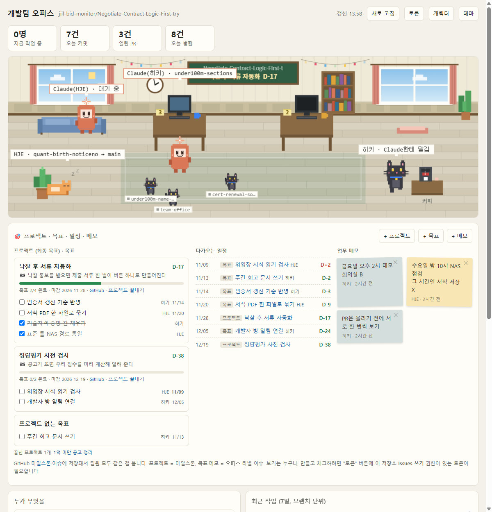
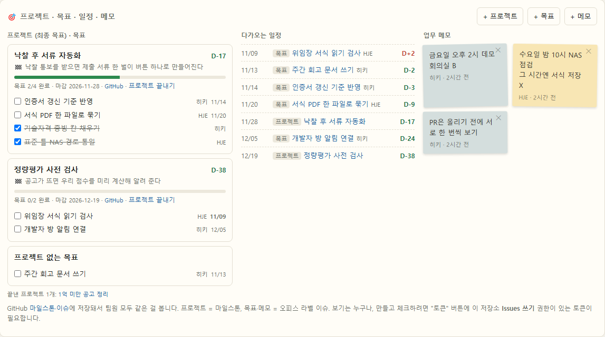
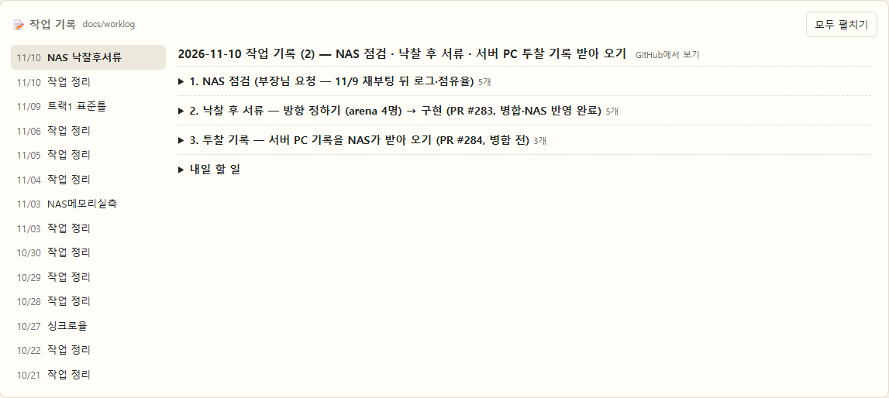
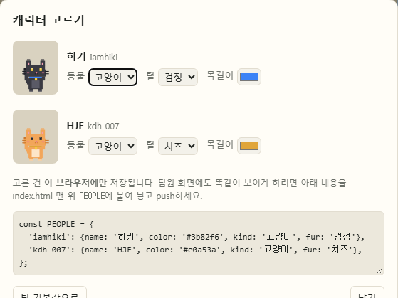

# 🐾 개발팀 오피스

> **GitHub 기록만 보고, 누가 지금 무엇을 하고 있는지** 픽셀 사무실로 보여 주는 현황판

따로 입력할 건 없습니다. 평소처럼 브랜치에 push하고 PR을 올리면 사무실이 알아서 움직입니다.
서버 없이 `index.html` 한 파일로 돌아가고, 브라우저가 GitHub API를 직접 읽습니다.



<sub>↑ 예시 화면. 큰 고양이 = 사람, 꼬마 고양이 = 진행 중인 브랜치, 주황색 친구 = Claude</sub>

---

## 👀 화면 읽는 법

### 사무실 식구들

| 누구 | 뜻 |
|---|---|
| 🐈 **큰 동물** | 팀원 한 명. 목걸이 색이 그 사람 색이고, 말풍선에 이름과 지금 브랜치가 나옵니다 (`→ main`이면 방금 main에 넣음) |
| 🐱 **꼬마 동물** | 아직 main에 안 들어간 **진행 중인 브랜치** 하나. 이름표에 브랜치 이름이 있고, 주인 자리 근처에서 놉니다 (한 사람당 최대 3마리) |
| 🧡 **Claude** | Claude Code. 일이 없을 땐 사무실에서 **대기 중**, 누가 Claude한테 일을 맡기면 그 사람 자리에 앉아 타닥타닥 |

### 상태 표시

| 표시 | 언제 | 사무실에서는 |
|---|---|---|
| 🟢 **작업 중** | 30분 안에 push | 모니터가 켜지고 자리에서 타닥타닥, 가끔 기지개 산책 |
| 🟡 **조금 전까지** | 3시간 안에 push | 자리와 사무실을 오가며 쉬엄쉬엄 |
| ⚪ **자리 비움** | 그 밖 | 커피 머신·창가 소파·동료 자리를 돌아다니다 낮잠 💤 |
| 🟠 **Claude 작업 중** | `claude/` 브랜치에 30분 안에 push | Claude가 자리에 앉고, 주인은 옆에서 구경 ♪ |
| 💻 **꼬마 노트북** | 그 브랜치에 30분 안에 push | 꼬마가 노트북을 펴고 작업, 이름표 점이 초록으로 깜빡 |

🐟 **심심할 땐 츄르**: 사무실 바닥을 누르면 그 자리에 츄르가 놓이고, 가장 가까운 친구가 달려와 냠냠 먹습니다.
☕ **커피 만들기**: 커피 머신을 누르면 메뉴판이 뜹니다. 누가 마실지와 음료(아메리카노·카페라떼·바닐라라떼·녹차·핫초코·딸기우유)를 고르면 그 친구가 머신 앞에 가서 한 잔 마십니다. "모두에게 한 잔씩 돌리기"도 됩니다.

창밖은 한국 시간에 맞춰 낮 ☀️ · 노을 🌇 · 밤 🌙 으로 바뀌고, 벽시계도 지금 시각을 가리킵니다.

### 아래 카드

- **누가 무엇을**: 사람별 브랜치 · 마지막 커밋 · 오늘 커밋 수 · 열린 PR
- **최근 작업 (7일)**: 커밋을 브랜치(PR) 단위로 묶어서. "커밋 n건 보기"를 누르면 원래 커밋

---

## 🎯 프로젝트 · 목표 · 일정 · 메모



<sub>↑ 예시 화면</sub>

사무실 바로 아래 보드에서 팀이 같이 봅니다. **GitHub 마일스톤·이슈에 저장**되니, GitHub에서 직접 고쳐도 그대로 반영됩니다.

| 보드에서 | GitHub에서는 | 버튼 |
|---|---|---|
| **프로젝트** (최종 목표 + 마감일) | 마일스톤 | `+ 프로젝트` |
| **목표** (담당 · 마감일, 체크하면 완료) | `오피스` 라벨 이슈 — 마감일은 본문의 `마감: 2026-11-30` 줄 | `+ 목표` |
| **일정** | 마감일 있는 프로젝트·목표를 날짜순으로 자동 정리 (D-day) | — |
| **메모** (포스트잇, ✕로 떼기) | `오피스` + `메모` 라벨 이슈 | `+ 메모` |

사무실에도 보입니다. 칠판에 **가장 가까운 프로젝트와 D-day**, 책상 포스트잇에 **그 사람이 맡은 목표 수**.

> 🔑 **보기는 누구나** 됩니다. **만들고 체크하려면** 오른쪽 위 **토큰** 버튼에 토큰을 한 번 넣어 두세요.
> GitHub → Settings → Developer settings → Fine-grained tokens → 저장소 선택 → Repository permissions → **Issues: Read and write**
> 토큰은 내 브라우저에만 저장됩니다.

---

## 📝 작업 기록



저장소의 `docs/worklog/` 폴더에 올린 작업 기록(`2026-11-10.md`, `2026-11-10_주제.md` …)을 날짜순으로 보여 줍니다.
`## 섹션` 제목만 한 줄씩 정리해서 보여 주고, 누르면 내용이 펼쳐집니다. "할 일" 섹션은 처음부터 펼쳐 둡니다.
평소처럼 md 파일을 커밋하기만 하면 됩니다.

아래 **최근 작업 (7일)** 에도 날짜마다 그날 작업 기록의 정리본(제목 + 섹션 제목)이 먼저 나오고, "자세히"를 누르면 이 카드에서 열립니다.

---

## 🎨 내 캐릭터 고르기



1. 오른쪽 위 **캐릭터** 버튼
2. 동물(고양이 · 강아지 · 토끼 · 곰), 털 색(치즈 · 회색 · 검정 · 흰 · 갈색), 목걸이 색을 고르면 바로 바뀝니다

> 💡 **토큰을 넣어 두었으면** 고르는 즉시 팀 공용으로 저장돼서(작업 저장소의 `오피스` + `설정` 라벨 이슈) **팀원 화면에도 똑같이** 보입니다.
> 토큰이 없으면 내 브라우저에만 저장됩니다.

---

## 🚀 여는 법

| 방법 | |
|---|---|
| 웹으로 | `https://iamhiki.github.io/team-office/` — 저장소 Settings → Pages → `main` / `(root)` 로 켜 두면 됩니다 |
| 파일로 | `index.html`을 더블클릭해도 똑같이 동작합니다 |
| 다른 저장소 보기 | 주소 뒤에 `?repo=owner/name` |

---

## ❓ 자주 묻는 것

<details>
<summary><b>브랜치를 새로 만들면 캐릭터가 늘어나나요?</b></summary>

큰 동물은 **사람마다 한 마리**라 늘지 않습니다. 대신 브랜치마다 **꼬마 동물**이 생기고, main에 병합되면 문으로 퇴근합니다.
새 사람이 push하면 그 사람 동물이 새로 생깁니다 (사무실에는 최대 6명).
</details>

<details>
<summary><b>Claude가 일하는 건 어떻게 알아요?</b></summary>

가장 최근 push가 `claude/` 브랜치이거나 커밋 작성자가 Claude이면 Claude Code 작업으로 봅니다.
30분 안에 push가 있고 아직 main에 안 넣었으면 "Claude 작업 중". 커밋 작성자가 전부 Claude여도, 실제로 push한 사람 이름으로 붙입니다.
</details>

<details>
<summary><b>push했는데 "작업 중"이 바로 안 떠요</b></summary>

push 기록은 GitHub에 올라가는 즉시 잡히지만, 화면은 **토큰이 없으면 30분마다, 토큰을 넣으면 5분마다** 새로 고칩니다. 바로 보려면 **새로 고침** 버튼을 누르세요.
내 PC에서 커밋만 하고 push하지 않은 작업은 GitHub가 모르니 보이지 않습니다.
</details>

<details>
<summary><b>"조회 한도 초과"가 떠요</b></summary>

토큰 없이는 GitHub가 **IP당 시간당 60회**만 허락합니다. 한 번 새로 고칠 때 8~10회를 쓰고 30분마다 새로 고치니, 같은 사무실에서 두 명까지는 괜찮습니다.
더 필요하면 **토큰** 버튼에 읽기 전용 토큰(공개 저장소면 권한 없이 만든 토큰도 됨)을 넣으세요. 시간당 5,000회로 늘어나고, 토큰은 내 브라우저에만 저장됩니다.
비공개 저장소는 그 저장소를 읽을 수 있는 토큰이 있어야 합니다.
</details>

---

## ⚙️ 설정 (`index.html` 맨 위)

```js
const REPO = ... || 'jiil-bid-monitor/Negotiate-Contract-Logic-First-try';   // 기본으로 볼 저장소

const PEOPLE = {   // GitHub 로그인 → 이름 · 목걸이 색 · 동물 · 털 (없는 사람은 자동 추가)
  'iamhiki': {name: '히키', color: '#3b82f6', kind: '고양이', fur: '검정'},
  'kdh-007': {name: 'HJE', color: '#e0a53a', kind: '고양이', fur: '치즈'},
};

const BOARD_REPO = ... || REPO;   // 프로젝트·목표·메모를 둘 저장소 (기본은 위와 같음, ?board=owner/name)

const WORKLOG_DIR = ... || 'docs/worklog';   // 작업 기록 md 폴더 (?worklog=경로)

const POLL_MS = 30 * 60 * 1000;   // 새로 고침 주기 (30분)
```
